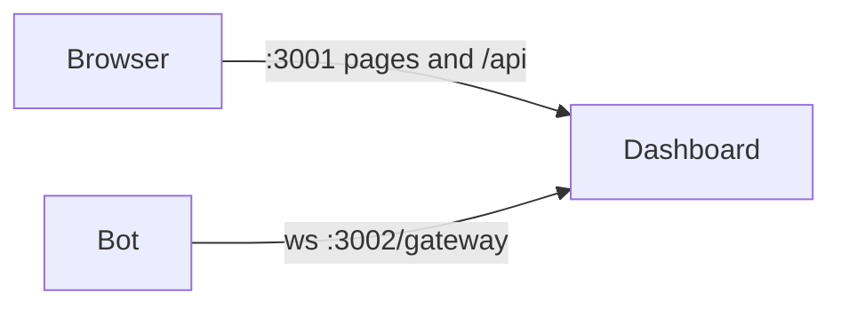

In remote mode the dashboard is a server of its own and your bot connects out to
it. The bot keeps its settings wherever it likes and answers the dashboard's
calls. This suits a bot that isn't written in JavaScript, a sharded bot, or a
bot and dashboard that run on different machines.



The bot authenticates with a bot id and a shared secret. The connection is
outbound from the bot, so the bot needs no open port.

## 1. Run the dashboard server

The server is built from the published packages:

```bash
npm install @asctane-dashboard/core @asctane-dashboard/platform-discord @asctane-dashboard/schema @asctane-dashboard/web
```

```js server.js
import { createServer } from "node:http"
import {
  EventHub,
  RemoteAdapter,
  StatsRegistry,
  buildDefFromAdapter,
  buildServer,
  startGateway,
  wireEvents,
  wireStats,
} from "@asctane-dashboard/core"
import { discord } from "@asctane-dashboard/platform-discord"
import { defineSettings } from "@asctane-dashboard/schema"
import { webRoot } from "@asctane-dashboard/web"

const botId = process.env.BOT_ID
const secret = process.env.DASHBOARD_SECRET
const publicUrl = process.env.PUBLIC_URL ?? "http://localhost:3001"
const platforms = [
  discord({
    clientId: process.env.DISCORD_CLIENT_ID,
    clientSecret: process.env.DISCORD_CLIENT_SECRET,
    redirectUri: `${publicUrl}/api/auth/discord/callback`,
  }),
]

// The bot gateway, on its own port. It only lets in your bot, with its secret.
const gatewayHttp = createServer()
const gateway = startGateway(gatewayHttp, async (id) => (id === botId ? secret : null))
gatewayHttp.listen(3002)

const events = new EventHub()
const stats = new StatsRegistry()
wireEvents(gateway, events)
wireStats(gateway, stats)

// Every call goes to the connected bot. The schema is asked for each time the
// bot connects, so a new bot version brings its new settings along.
const adapter = new RemoteAdapter(gateway, botId, { platform: "discord" })
let schema = defineSettings(() => ({}))
gateway.onConnect(async (id) => {
  if (id === botId) schema = await buildDefFromAdapter(adapter, undefined, platforms)
})

const app = await buildServer(
  {
    port: 3001,
    cookieSecret: process.env.COOKIE_SECRET,
    allowedOrigins: [publicUrl],
    platforms,
    webhookSecret: process.env.WEBHOOK_SECRET,
  },
  {
    def: () => schema,
    adapter,
    events,
    stats,
    web: { root: webRoot },
    ready: () => gateway.sessions.has(botId),
  }
)
await app.listen({ port: 3001, host: "0.0.0.0" })
```

Start it with `BOT_ID`, `DASHBOARD_SECRET`, `COOKIE_SECRET`, `DISCORD_CLIENT_ID`
and `DISCORD_CLIENT_SECRET` set. Pick a long random `DASHBOARD_SECRET` and give
the same value to the bot.

<Tip>
  `/ready` answers `503` until the bot is connected, so a load balancer can wait
  for it.
</Tip>

## 2. Connect the bot

<Tabs>
  <Tab title="Node">
    ```bash
    npm install @asctane-dashboard/sdk-js
    ```

    ```js bot.js
    import { Adapter, defineSettings, f } from "@asctane-dashboard/sdk-js"

    const settings = defineSettings((s) => ({
      general: s.category({
        name: "General",
        options: {
          prefix: f.text({ label: "Prefix", max: 3, default: "!" }),
          logChannel: f.ref("channel", { label: "Log channel", filter: { types: ["text"] } }),
        },
      }),
    }))

    new Adapter({
      botId: process.env.BOT_ID,
      secret: process.env.DASHBOARD_SECRET,
      gateway: "ws://localhost:3002/gateway",
    })
      .settings(settings)
      .onGet((spaceId, key) => db.get(spaceId, key))
      .onSet((spaceId, key, value) => db.set(spaceId, key, value))
      .onResources((spaceId, kind) => {
        const guild = client.guilds.cache.get(spaceId)
        if (!guild) return []
        const items = kind === "channel" ? guild.channels.cache : guild.roles.cache
        return items.map((item) => ({ label: item.name, value: item.id }))
      })
      .connect()
    ```
  </Tab>
  <Tab title="Python">
    ```bash
    pip install discord-dashboard
    ```

    ```python bot.py
    import os
    from discord_dashboard import Adapter, define_settings, f

    schema = define_settings({
        "general": {
            "name": "General",
            "options": {
                "prefix": f.text(label="Prefix", max=3, default="!"),
                "log_channel": f.channel(label="Log channel", types=["text"]),
            },
        }
    })

    adapter = Adapter(
        bot_id=os.environ["BOT_ID"],
        secret=os.environ["DASHBOARD_SECRET"],
        gateway="ws://localhost:3002/gateway",
    )
    adapter.settings(schema)
    adapter.on_get(lambda space_id, key: db.get(space_id, key))
    adapter.on_set(lambda space_id, key, value: db.set(space_id, key, value))


    def resources(space_id, kind):
        guild = bot.get_guild(int(space_id))
        if guild is None:
            return []
        items = guild.text_channels if kind == "channel" else guild.roles
        return [{"label": item.name, "value": str(item.id)} for item in items]


    adapter.on_resources(resources)

    if __name__ == "__main__":
        adapter.run()
    ```

    Handlers can be plain functions or coroutines. Inside a running asyncio
    program, such as a discord.py bot, start the adapter with
    `asyncio.create_task(adapter.start())` instead of `run()`.
  </Tab>
</Tabs>

## Handlers

| Handler | Called with | Returns |
| --- | --- | --- |
| `onGet` / `on_get` | space id, key | The stored value, or nothing for unset. |
| `onSet` / `on_set` | space id, key, value | Nothing. The value is already validated. |
| `onResources` / `on_resources` | space id, kind, filter | A list of `{ label, value }` for a picker. |
| `onPermissions` / `on_permissions` | space id, user id | The member's permissions, such as `["MANAGE_GUILD"]`. |
| `onAction` / `on_action` | space id, name, payload | Any JSON result. |

JavaScript handlers also get the acting user (`{ userId }`) and the platform id
as extra arguments. Python handlers get them, and a picker's `filter`, as the
keyword arguments `actor`, `platform` and `filter` if they declare them.

Without `onResources` the pickers are empty, and without `onPermissions` a
member has no permissions in the bot's eyes.

The dashboard fills in defaults itself, so `onGet` only returns what was
actually stored.

## Pushing changes

When a value changes inside the bot, for example through a slash command, tell
the dashboard so open forms update:

```js
adapter.push("setting.changed", { spaceId, key: "general.prefix", value: "?" })
```

In Python, `push` is a coroutine: `await adapter.push("setting.changed", {...})`.

The bot can also push `stats.push` with `{ guilds, users }`, which the server
keeps for `GET /api/bots/<botId>/stats`. See [Protocol](/reference/protocol#events)
for all events.

## Reconnecting

Both SDKs reconnect after a dropped connection, every second by default
(`reconnectMs` / `reconnect_ms`). The server pings every 30 seconds and drops a
connection that stops answering.
