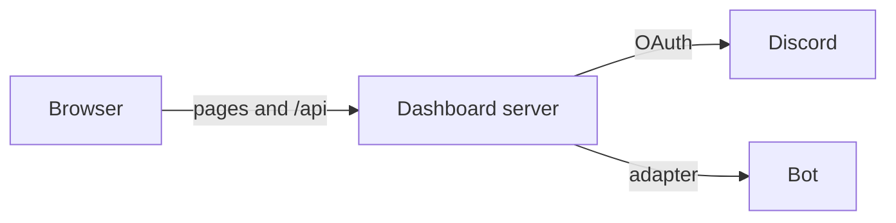

## The pieces

- **The dashboard server** is a Fastify app from `@asctane-dashboard/core`. It
  serves the web pages, the HTTP API under `/api`, OAuth login and a live update
  stream.
- **The web app** (`@asctane-dashboard/web`) is a prebuilt set of static pages.
  The server serves them on its own port, so the browser only ever talks to one
  origin.
- **The adapter** is how the server reaches your bot: to describe the settings,
  read and write values, and list channels and roles.
- **A platform** is a login provider and the source of spaces. v3 ships with
  Discord (`@asctane-dashboard/platform-discord`).

## Spaces

A space is the thing a setting belongs to. On Discord a space is a server
(guild). Every setting is stored per space, and a user can only open a space they
are allowed to manage. On Discord that means they own the server or have the
Manage Server permission. That list is taken from Discord at login.

The API and the protocol use the neutral words `space` and `spaceId`, so the same
core can serve other platforms later.

## Two ways to connect a bot

<CardGroup cols={2}>
  <Card title="Lite mode" icon="feather" href="/guides/lite-mode">
    The dashboard runs inside your discord.js process. One call,
    `createDashboard`, and settings are stored in memory, in SQLite or in your
    own store.
  </Card>
  <Card title="Remote bots" icon="plug" href="/guides/remote-bots">
    The dashboard runs as its own server and your bot connects to it over a
    WebSocket. The bot can be written in any language. SDKs exist for Node and
    Python.
  </Card>
</CardGroup>

Both modes run the same server and the same API. Only the adapter differs: lite
mode uses an in process adapter, and remote mode forwards each call to the
connected bot.

## Settings flow

1. The browser loads `/api/schema`, the settings schema in a JSON form that any
   language can produce.
2. It loads the current values of a space from `/api/spaces/discord/<id>/values`.
3. When an admin changes a field, the browser posts the new value. The server
   checks the session, the space permission and any entitlement, validates the
   value against the schema and only then hands it to the adapter.
4. The change is recorded in the audit log and pushed to every other admin who
   has the same space open.

Validation always happens on the server. The schema is the single source of
truth for both the form and the check.

## One port

By default everything is served from one address, for example
`http://localhost:3001`:

| Path | What |
| --- | --- |
| `/`, `/manage/`, `/dashboard/`, ... | The web app's pages |
| `/api/*` | The HTTP API, including login at `/api/auth/discord` |
| `/health`, `/ready`, `/metrics` | Probes for load balancers and monitoring |

A remote bot gateway runs on a WebSocket path, `/gateway`, which you can put on
its own port. See [Remote bots](/guides/remote-bots).
